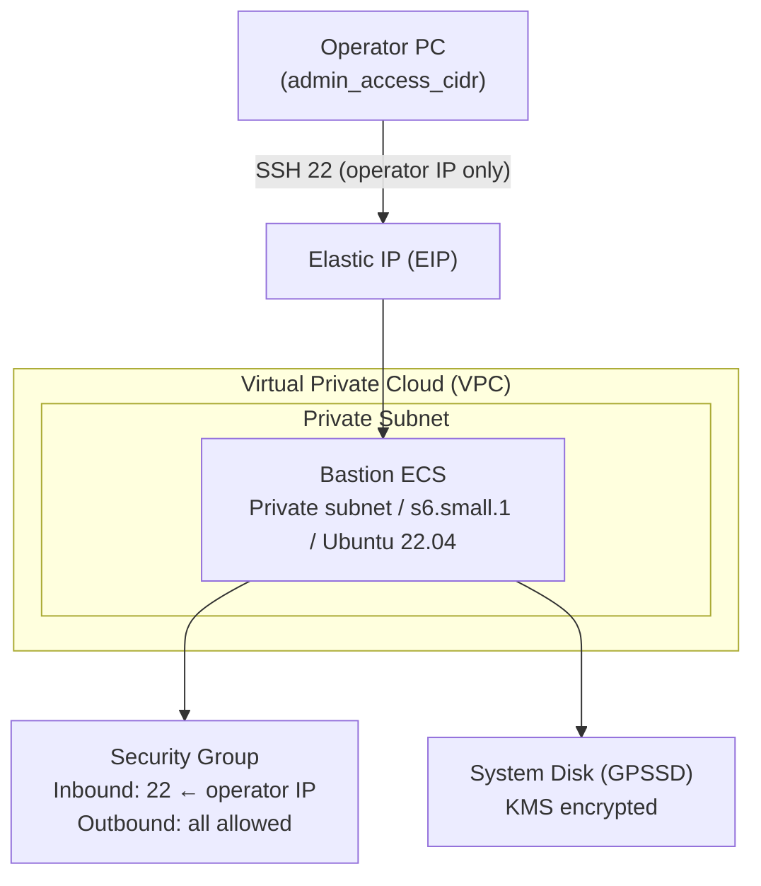

# Secured Bastion Host Reference Deployment (Huawei Cloud Terraform Practice)

[](./LICENSE)
[](#)
[](https://developer.huaweicloud.com/terra)

## 1. Overview

This reference deployment provides a **secured bastion host (Bastion Host)** on Huawei Cloud: an Elastic Cloud Server (ECS) is deployed inside a private subnet of a single Virtual Private Cloud (VPC) as the jump host, exposing a single controlled SSH (22) entry point to operators via an Elastic IP (EIP). The security group converges SSH inbound to the operator's public IP, and the system disk is encrypted with the Key Management Service (KMS). The entire configuration is orchestrated with Terraform and can be deployed and destroyed with one click.

Intended users: small and medium-sized cloud onboarding / cloud deployment projects / internal tool platforms that need a minimal exposure surface and static encryption for their operations entry point.

## 2. Table of Contents

- [Overview](#1-overview)
- [Architecture Diagram](#3-architecture-diagram)
- [Key Features](#4-key-features)
- [Huawei Cloud Services Used](#5-huawei-cloud-services-used)
- [Prerequisites](#6-prerequisites)
- [Quick Start](#7-quick-start)
- [Step-by-Step Deployment](#8-step-by-step-deployment)
- [Usage / Verification](#9-usage--verification)
- [Cleanup Resources](#10-cleanup-resources)
- [Detailed Explanation](#11-detailed-explanation)
- [Dependencies](#12-dependencies)
- [FAQ / Troubleshooting](#13-faq--troubleshooting)
- [Contributing](#14-contributing)
- [License](#15-license)
- [Contact / Maintainers](#16-contact--maintainers)

## 3. Architecture Diagram



## 4. Key Highlights

- **Minimal exposure surface**: The bastion host sits in a private subnet; EIP + security group together converge SSH inbound to the operator's IP.
- **Static encryption**: The system disk enables KMS encryption by default; the key is created together with the instance.
- **Infrastructure as Code**: Pure Terraform orchestration, one-click deploy and destroy, easy to reuse across multiple environments.
- **Modular split**: Root module + VPC submodule + bastion submodule, with clear responsibilities and easy extensibility.
- **No plaintext credentials**: AK/SK — see §6.1; key pairs via the `ssh_public_key` variable in `dev.tfvars`; no credentials are written to disk.

## 5. Huawei Cloud Services Used

| Service | Purpose |
|---|---|
| Virtual Private Cloud (VPC) | Isolated private network for the bastion host |
| Elastic Cloud Server (ECS) | Compute resource for the bastion host |
| Elastic IP (EIP) | Controlled public entry for the bastion host (**public entry — read the cleanup note in Section 10 before deployment**) |
| Key Management Service (KMS) | System disk encryption key |
| Security Group | Converges SSH (22) inbound to the operator's IP |

> After destruction, it is recommended to verify in the console that all resources have been released to avoid residue.

## 6. Prerequisites

### 6.1 Credentials and Leak Prevention

This repository requires two kinds of credentials: the Huawei Cloud AK/SK (for accessing the Huawei Cloud APIs) and the SSH key pair (for logging into the bastion host). Subsequent references to credentials in this document all point to this section.

**Huawei Cloud AK/SK**:

- Obtain: in the Huawei Cloud console go to "My Credentials" → "Access Keys" → "Create Access Key", and save the Access Key ID and Secret Access Key (the Secret is shown only once after creation — record it safely).
- Use temporarily: run `export HW_ACCESS_KEY="<your-access-key>"` and `export HW_SECRET_KEY="<your-secret-key>"`, then immediately invoke Terraform. **Do not** save the credentials into any file, `.tfvars`, `.tf`, screenshot, or chat tool.
- Leak prevention: if you suspect the credentials are leaked, immediately **delete** the Access Key in the "My Credentials" page and create a new one.

**SSH key pair**:

- Generate: `ssh-keygen -t ed25519 -f ~/.ssh/sandbox-dev-bastion-key -C "bastion-comment"`.
- Inject: paste the contents of `~/.ssh/sandbox-dev-bastion-key.pub` into the `ssh_public_key` field in `infra/dev.tfvars`. The **private key** stays locally and never appears in the repository.

### 6.2 Tools and Region

| Item | Requirement |
|---|---|
| Huawei Cloud account | Activated, with permissions to create VPC / ECS / EIP / KMS / Security Group |
| Terraform | >= 1.5 (1.9+ recommended); `terraform` callable from local CLI |
| huaweicloud Provider | ~> 1.97 (auto-fetched by `terraform init`) |
| Region | Default `cn-north-4` (North-China-Beijing IV); adjustable via `region` in `infra/variables.tf` |
| Access credentials | Huawei Cloud AK/SK — see §6.1 |
| SSH key pair | Prepare the public key generated by `ssh-keygen` (OpenSSH format); keep the private key locally |

## 7. Quick Start

```bash
cd <repository-root>/infra
export HW_ACCESS_KEY="<your-access-key>"
export HW_SECRET_KEY="<your-secret-key>"

# Edit dev.tfvars: change admin_access_cidr to your public IP, ssh_public_key to your public key
terraform init
terraform apply -var-file=dev.tfvars
```

After `apply` completes:

```bash
terraform output bastion_eip_address   # get the public IP
./src/connect-bastion.sh $(terraform output -raw bastion_eip_address)
```

## 8. Step-by-Step Deployment

### 8.1 Initialize and Validate

```bash
cd <repository-root>/infra
terraform init
terraform validate       # Expected: Success! The configuration is valid
terraform fmt -recursive -check
```

### 8.2 Prepare Variables

Edit `dev.tfvars`, at minimum change:

- `admin_access_cidr`: your public IP (recommend `/32`, e.g. `"203.0.113.10/32"`)
- `ssh_public_key`: your SSH public key

### 8.3 Preview

```bash
terraform plan -var-file=dev.tfvars
```

### 8.4 Deploy

```bash
terraform apply -var-file=dev.tfvars
```

Expected tail output: `Apply complete! Resources: 8 added, 0 changed, 0 destroyed.`

### 8.5 View Outputs

```bash
terraform output
```

Key fields: `bastion_eip_address`, `bastion_instance_id`, `bastion_security_group_id`, `bastion_private_subnet_id`, `bastion_vpc_id`.

## 9. Usage / Verification

> **After deployment, please verify following the steps in this section to confirm the business function works, before considering the delivery complete.**

### 9.1 Verification Checklist

| Step | Checkpoint | Command | Expected |
|---|---|---|---|
| ① | All resources created | `terraform state list` | 8 resources listed (VPC / Subnet / SG / SG rules ×2 / Instance / EIP / EIP association, etc.) |
| ② | Instance visible in console | Console → ECS → Instances | Status "Running" |
| ③ | SSH reachable | `./src/connect-bastion.sh <eip>` | Interactive shell entered |
| ④ | Inbound whitelist converged | Console → VPC → Security Group → Inbound rules | SSH (22) source is your IP (default placeholder `0.0.0.0/0` means not yet converged) |
| ⑤ | System disk encrypted | Console → ECS → Instance → Disks | System disk "Encrypted" flag is "Yes" |

### 9.2 Example: End-to-End Connectivity Verification

```bash
ssh -i ~/.ssh/sandbox-dev-bastion-key ubuntu@<bastion_eip_address> "whoami && uname -a"
```

Expected: `whoami` outputs `ubuntu`; `uname -a` outputs the Linux kernel version.

> If SSH connection times out, go back to §6 and check whether `admin_access_cidr` includes your current public IP, and see §13 Troubleshooting.

## 10. Cleanup Resources

```bash
cd <repository-root>/infra
terraform destroy -var-file=dev.tfvars
```

> After destruction, it is recommended to verify in the console (ECS / EIP / VPC / KMS) that there is no residue and resources are released.

## 11. Detailed Explanation

See also:

- [docs/architecture.md](docs/architecture.md) — architecture components, security design notes, directory layout
- [docs/deployment-guide.md](docs/deployment-guide.md) — deployment steps, variable reference, remote state integration

### 11.1 Key Variables (`infra/variables.tf`)

| Variable | Default | Description |
|---|---|---|
| `region` | `cn-north-4` | Huawei Cloud region |
| `target_environment` | `dev` | Environment identifier |
| `tag_application` | `sandbox` | Application identifier |
| `vpc_cidr` | `10.10.0.240/28` | VPC CIDR |
| `vpc_private_subnets` | `["10.10.0.240/28"]` | Private subnet CIDR list (first item used) |
| `instance_type` | `s6.small.1` | Bastion ECS flavor |
| `admin_access_cidr` | `0.0.0.0/0` | SSH (22) inbound source CIDR (**change to operator `/32` for production**) |
| `ssh_public_key` | placeholder | OpenSSH public key (replace with your real public key) |
| `encrypt_system_disk` | `true` | System disk KMS encryption switch |
| `image_os` / `image_os_version` | `Ubuntu` / `22.04` | Public image filter conditions |

## 12. Dependencies

- Terraform / [huaweicloud Provider](https://registry.terraform.io/providers/huaweicloud/huaweicloud)
- Key reference: [Huawei Cloud Best Practices](https://support.huaweicloud.com/bestpractice-sdrs/sdrs_bp_cbr_0003.html)

## 13. FAQ / Troubleshooting

**Q1: SSH connection times out?**

- Check whether `admin_access_cidr` includes your current public IP (`curl https://ifconfig.me` to obtain it).
- Check whether the security group inbound rule is correct (Console → VPC → Security Group).
- Check whether the EIP is successfully bound to the ECS (Console → ECS → Network).

**Q2: `terraform validate` reports provider not found?**

- Confirm `terraform init` ran successfully; or, on a restricted network, follow `docs/deployment-guide.md` §4 to load the local provider binary via offline `dev_overrides`.

**Q3: Console shows ECS status "Creation failed"?**

- The regional image filter may be empty: try a broader match for `image_os` / `image_os_version` (e.g. `os = "Ubuntu"`).
- Subnet CIDR conflict: adjust `vpc_cidr` / `vpc_private_subnets`.

## 14. Contributing

Issues and improvement PRs are welcome. This practice is released under the `MIT No Attribution` license; contributors agree to release their contributions under that license.

## 15. License

This practice is released under the **MIT No Attribution** license (see [LICENSE](./LICENSE)). It permits copying, modification, merging, publishing, distribution, sublicensing, and selling copies of the software without attribution.

## 16. Contact / Maintainers

| Item | Content |
|---|---|
| **Creator** | [@<dgc-git>](https://github.com/dgc-git) |
| **Maintainer** | [@<dgc-git>](https://github.com/dgc-git) |
| **Feedback channel** | Submit an Issue or Pull Request in the repository |
