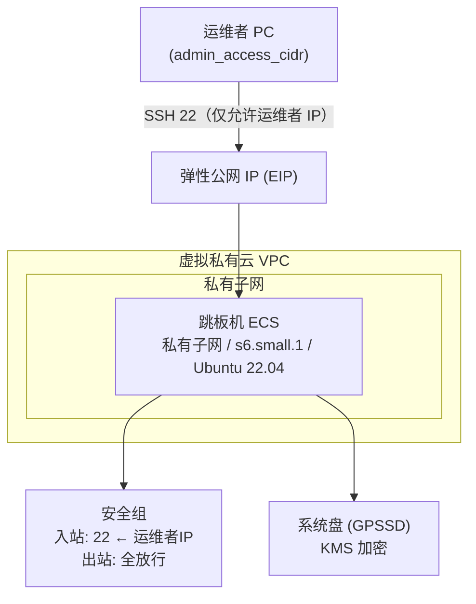

# 安全跳板机参考部署（华为云 Terraform 实践）

[](./LICENSE)
[](#)
[](https://developer.huaweicloud.com/terra)

## 1. 简介

本实践提供一个**安全跳板机（Bastion Host）**的华为云参考部署：在单个虚拟私有云
（VPC）的私有子网内部署一台弹性云服务器（ECS）作为跳板机，通过弹性公网 IP（EIP）
向运维者暴露**唯一受控的 SSH(22) 入口**，安全组将 SSH 入站收敛到运维者公网 IP，
系统盘启用密钥管理服务（KMS）加密。整套配置以 Terraform 编排，可一键部署与销毁。

适用对象：需要为运维入口提供最小暴露面与静态加密的中小企业上云项目 / 内部工具平台。

## 2. 目录

- [简介](#1-简介)
- [架构图](#3-架构图)
- [方案亮点](#4-方案亮点)
- [涉及云服务](#5-涉及云服务)
- [前置条件](#6-前置条件)
- [快速开始](#7-快速开始)
- [分步部署](#8-分步部署)
- [使用方法/验证](#9-使用方法验证)
- [清理资源](#10-清理资源)
- [详细说明](#11-详细说明)
- [依赖](#12-依赖)
- [FAQ / 故障排除](#13-faq--故障排除)
- [贡献指南](#14-贡献指南)
- [许可证](#15-许可证)
- [联系方式/维护者](#16-联系方式维护者)

## 3. 架构图



## 4. 方案亮点

- **最小暴露面**：跳板机置于私有子网，EIP + 安全组双重收敛 SSH 入站到运维者 IP。
- **静态加密**：系统盘默认启用 KMS 加密，密钥与实例一同创建。
- **基础设施即代码**：纯 Terraform 编排，一键部署与销毁，便于复用到多套环境。
- **模块化拆分**：根模块 + VPC 子模块 + 跳板机子模块，职责清晰、易扩展。
- **无明文凭证**：AK/SK 参见 §6.1，密钥对通过 `dev.tfvars` 的 `ssh_public_key` 传入；仓库内无凭据落盘。

## 5. 涉及云服务

| 服务 | 用途 |
|---|---|
| 虚拟私有云 VPC | 隔离跳板机的私有网络 |
| 弹性云服务器 ECS | 跳板机计算资源 |
| 弹性公网 IP EIP | 跳板机的受控公网入口（**公网入口，部署前请阅读第 10 章清理提示**） |
| 数据加密密钥服务 KMS | 系统盘加密密钥 |
| 安全组 Security Group | 收敛 SSH(22) 入站到运维者 IP |

> 销毁时建议到控制台确认所有资源已释放，避免残留。

## 6. 前置条件

### 6.1 凭据获取与防泄露

本仓库需要两类凭据：华为云 AK/SK（访问华为云 API）与 SSH 密钥对（登录跳板机）。后文
出现凭据的位置，统一引用本节。

**华为云 AK/SK**：

- 获取：在华为云控制台「我的凭证」→「访问密钥」→「新增访问密钥」，记下 Access Key ID
  与 Secret Access Key（关闭页面后只显示一次 Secret，请妥善记录）。
- 临时使用：`export HW_ACCESS_KEY="<your-access-key>"`、`export HW_SECRET_KEY="<your-secret-key>"` 后
  立即运行 Terraform；**不要**把凭据保存到任何文件、`.tfvars`、`.tf`、截图或聊天工具。
- 防泄露：如怀疑凭据已泄露，立即到「我的凭证」页面**删除**该 Access Key 并重建。

**SSH 密钥对**：

- 生成：`ssh-keygen -t ed25519 -f ~/.ssh/sandbox-dev-bastion-key -C "bastion-comment"`。
- 注入：将 `~/.ssh/sandbox-dev-bastion-key.pub` 内容粘贴到 `infra/dev.tfvars` 的
  `ssh_public_key` 字段。**私钥**留在本地，仓库内不出现。

### 6.2 工具与区域

| 项 | 要求 |
|---|---|
| 华为云账号 | 已开通并具备 VPC / ECS / EIP / KMS / 安全组 创建权限 |
| Terraform | >= 1.5（推荐 1.9+），本地命令可调用 `terraform` |
| huaweicloud Provider | ~> 1.97（`terraform init` 会自动拉取） |
| 区域 | 默认 `cn-north-4`（华北-北京四），可在 `infra/variables.tf` 的 `region` 调整 |
| 访问凭据 | 华为云 AK/SK；参见 §6.1 |
| SSH 密钥对 | 准备好 `ssh-keygen` 生成的公钥（OpenSSH 格式），将私钥放在本地 |

## 7. 快速开始

```bash
cd <本仓库根目录>/infra
export HW_ACCESS_KEY="<your-access-key>"
export HW_SECRET_KEY="<your-secret-key>"

# 修改 dev.tfvars：admin_access_cidr 改为你的公网 IP，ssh_public_key 改为你的公钥
terraform init
terraform apply -var-file=dev.tfvars
```

`apply` 完成后：

```bash
terraform output bastion_eip_address   # 拿到公网 IP
./src/connect-bastion.sh $(terraform output -raw bastion_eip_address)
```

## 8. 分步部署

### 8.1 初始化与校验

```bash
cd <本仓库根目录>/infra
terraform init
terraform validate       # 预期：Success! The configuration is valid
terraform fmt -recursive -check
```

### 8.2 变量准备

编辑 `dev.tfvars`，至少修改：

- `admin_access_cidr`：改为你的公网 IP（推荐 `/32`，如 `"203.0.113.10/32"`）
- `ssh_public_key`：改为你的 SSH 公钥

### 8.3 预演

```bash
terraform plan -var-file=dev.tfvars
```

### 8.4 部署

```bash
terraform apply -var-file=dev.tfvars
```

预期输出末尾 `Apply complete! Resources: 8 added, 0 changed, 0 destroyed.`

### 8.5 查看输出

```bash
terraform output
```

主要字段：`bastion_eip_address`、`bastion_instance_id`、`bastion_security_group_id`、
`bastion_private_subnet_id`、`bastion_vpc_id`。

## 9. 使用方法/验证

> **部署完成后，请按本节步骤自行验证，确认业务功能可用，方可视为交付完成。**

### 9.1 验证清单

| 步骤 | 验证点 | 命令 | 预期 |
|---|---|---|---|
| ① | 资源全部创建成功 | `terraform state list` | 列出 8 个资源（VPC/Subnet/SG/SG规则×2/Instance/EIP/EIPAssociation 等） |
| ② | 控制台可见实例 | 登录控制台 → ECS → 实例 | 状态「运行中」 |
| ③ | SSH 可达 | `./src/connect-bastion.sh <eip>` | 进入交互式 shell |
| ④ | 入站白名单收敛 | 登录控制台 → VPC → 安全组 → 入方向规则 | SSH(22) 源为你的 IP（默认占位 `0.0.0.0/0` 时未收敛） |
| ⑤ | 系统盘加密 | 登录控制台 → ECS → 实例 → 磁盘 | 系统盘「加密」标识为「是」 |

### 9.2 示例：端到端连通性验证

```bash
ssh -i ~/.ssh/sandbox-dev-bastion-key ubuntu@<bastion_eip_address> "whoami && uname -a"
```

预期：`whoami` 输出 `ubuntu`；`uname -a` 输出 Linux 内核版本。

> 如 SSH 连接超时，请回到 §6 检查 `admin_access_cidr` 是否包含当前公网 IP，以及 §13 故障排除。

## 10. 清理资源

```bash
cd <本仓库根目录>/infra
terraform destroy -var-file=dev.tfvars
```

> 销毁后建议到控制台（ECS / EIP / VPC / KMS）确认无残留，释放资源。

## 11. 详细说明

详见：

- [docs/architecture.md](docs/architecture.md) — 架构组件、安全设计要点、目录布局
- [docs/deployment-guide.md](docs/deployment-guide.md) — 部署步骤、变量说明、远程状态接入

### 11.1 主要变量（`infra/variables.tf`）

| 变量 | 默认值 | 说明 |
|---|---|---|
| `region` | `cn-north-4` | 华为云区域 |
| `target_environment` | `dev` | 环境标识 |
| `tag_application` | `sandbox` | 应用标识 |
| `vpc_cidr` | `10.10.0.240/28` | VPC CIDR |
| `vpc_private_subnets` | `["10.10.0.240/28"]` | 私有子网 CIDR 列表（取首个） |
| `instance_type` | `s6.small.1` | 跳板机 ECS 规格（flavor） |
| `admin_access_cidr` | `0.0.0.0/0` | SSH(22) 入站源 CIDR（**生产务必改为运维者 `/32`**） |
| `ssh_public_key` | 占位 | OpenSSH 公钥（替换为你的真实公钥） |
| `encrypt_system_disk` | `true` | 系统盘 KMS 加密开关 |
| `image_os` / `image_os_version` | `Ubuntu` / `22.04` | 公共镜像筛选条件 |

## 12. 依赖

- Terraform / [huaweicloud Provider](https://registry.terraform.io/providers/huaweicloud/huaweicloud)
- 主要参考：[公有云最佳实践](https://support.huaweicloud.com/bestpractice-sdrs/sdrs_bp_cbr_0003.html)

## 13. FAQ / 故障排除

**Q1：SSH 连接超时？**
- 检查 `admin_access_cidr` 是否包含你当前公网 IP（`curl https://ifconfig.me` 获取）。
- 检查安全组入站规则是否正确（控制台 → VPC → 安全组）。
- 检查 EIP 是否已成功绑定到 ECS（控制台 → ECS → 网络）。

**Q2：`terraform validate` 报 provider 未找到？**
- 确认 `terraform init` 已成功执行；或在受限网络下按 `docs/deployment-guide.md` §4 使用
  离线 dev_overrides 加载本地 provider 二进制。

**Q3：控制台 ECS 状态为「创建失败」？**
- 区域镜像筛选可能为空：`image_os` / `image_os_version` 试改为更宽匹配（如 `os = "Ubuntu"`）。
- 子网网段冲突：调整 `vpc_cidr` / `vpc_private_subnets`。

## 14. 贡献指南

欢迎通过 Issue 报告问题或提交改进 PR。本实践采用 `MIT No Attribution` 许可证，
贡献者同意按该许可证发布其贡献。

## 15. 许可证

本实践采用 **MIT No Attribution** 许可证发布（见 [LICENSE](./LICENSE)）。
允许复制、修改、合并、发布、分发、再授权及销售本软件副本，无需署名。

## 16. 联系方式/维护者

| 项 | 内容 |
|---|---|
| **创建者** | [@<dgc-git>](https://github.com/dgc-git)|
| **维护者** | [@<dgc-git>](https://github.com/dgc-git)|
| **反馈渠道** | 在仓库内提交 Issue 或 Pull Request |
