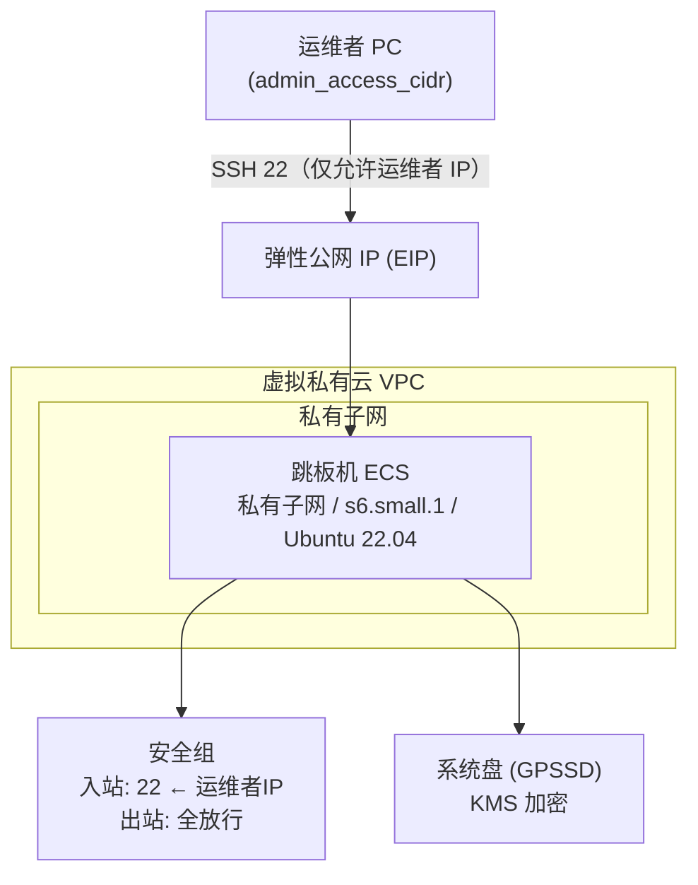

# 架构说明

## 1. 架构总览

本实践提供一个**安全跳板机（Bastion Host）**参考部署：在单个虚拟私有云（VPC）的
私有子网内部署一台弹性云服务器（ECS）作为跳板机，通过弹性公网 IP（EIP）向运维者
暴露**唯一受控的 SSH(22) 入口**，安全组将 SSH 入站收敛到运维者公网 IP；系统盘启用
密钥管理服务（KMS）加密，满足「最小暴露面 + 静态加密」的安全基线。



## 2. 组件与职责

| 组件 | 服务 | 职责 |
|---|---|---|
| 网络边界 | 虚拟私有云 VPC + 私有子网 | 隔离跳板机于私有网段，无直接公网路由 |
| 受控入口 | 弹性公网 IP EIP + 安全组 | 仅向运维者 IP 开放 SSH(22)；出站默认全放行 |
| 跳板机 | 弹性云服务器 ECS | 运维跳板，密钥对登录，无长期明文凭证 |
| 静态加密 | 数据加密密钥服务 KMS | 系统盘加密密钥，依赖 EVS 存储层默认加密 |
| 镜像 | 公共镜像（Ubuntu 22.04） | 区域可用时自动选取最新版本 |

## 3. 安全设计要点

- **最小暴露面**：跳板机位于私有子网，仅经 EIP 暴露单个 SSH(22) 端口；安全组入站
  规则源 CIDR 默认占位 `0.0.0.0/0`，生产环境务必改为运维者公网 IP（如 `1.2.3.4/32`）。
- **静态加密**：系统盘启用 KMS 加密，密钥默认创建（可通过 `encrypt_system_disk`
  开关关闭，仅用于测试）。
- **无明文凭证**：登录使用密钥对；AK/SK 参见 §2，仓库内无凭据落盘。
- **单一可用区**：采用单 AZ 私有子网部署；如需高可用可横向扩展
  为多子网 / 多可用区。

## 4. 目录与代码布局

```text
secured-bastion-host-terraform/
├── infra/                 # Terraform 根模块 + 子模块
│   ├── main.tf            # 根：provider、可用区、模块编排
│   ├── variables.tf       # 根变量（含 admin_access_cidr 等）
│   ├── outputs.tf         # 输出：VPC/子网/安全组/实例/EIP
│   ├── dev.tfvars         # 示例变量（占位，无真实凭据）
│   ├── bastion-vpc/       # 子模块：VPC + 私有子网 + 安全组
│   └── bastion-host/      # 子模块：ECS + 密钥对 + KMS + EIP
├── docs/                  # 本文档与部署指南
├── src/                   # 连接助手脚本
└── LICENSE                # MIT No Attribution
```

## 5. 设计约束与已知限制

- 跳板机经 EIP 暴露 SSH 入口；生产环境务必收敛 `admin_access_cidr` 到运维者 IP。
- 本实践聚焦最小可用形态，不含高可用、审计日志（云堡垒机 CBH）、多可用区等企业生产特性，按需扩展。
- 资源销毁见 `README.md` 的「清理资源」章节，避免残留。
